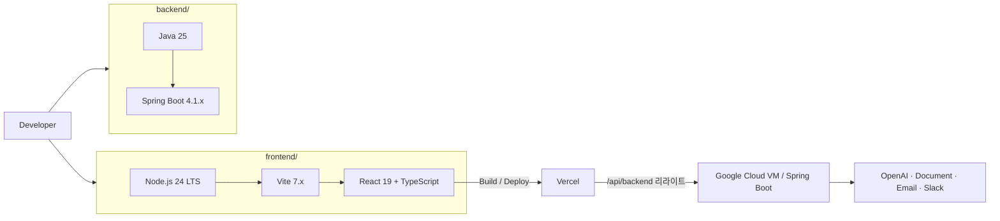
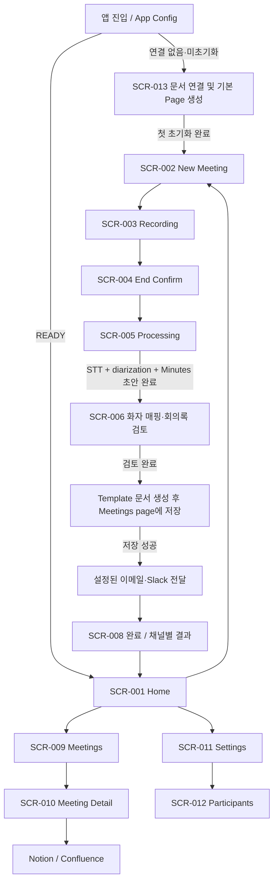
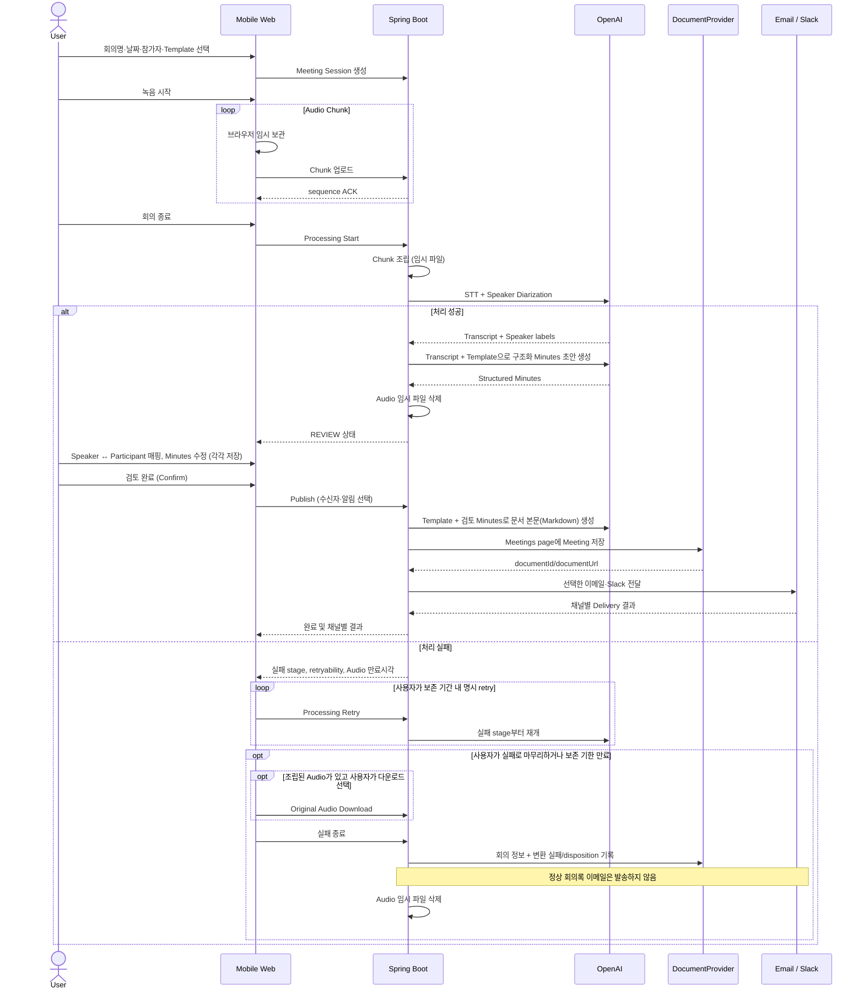
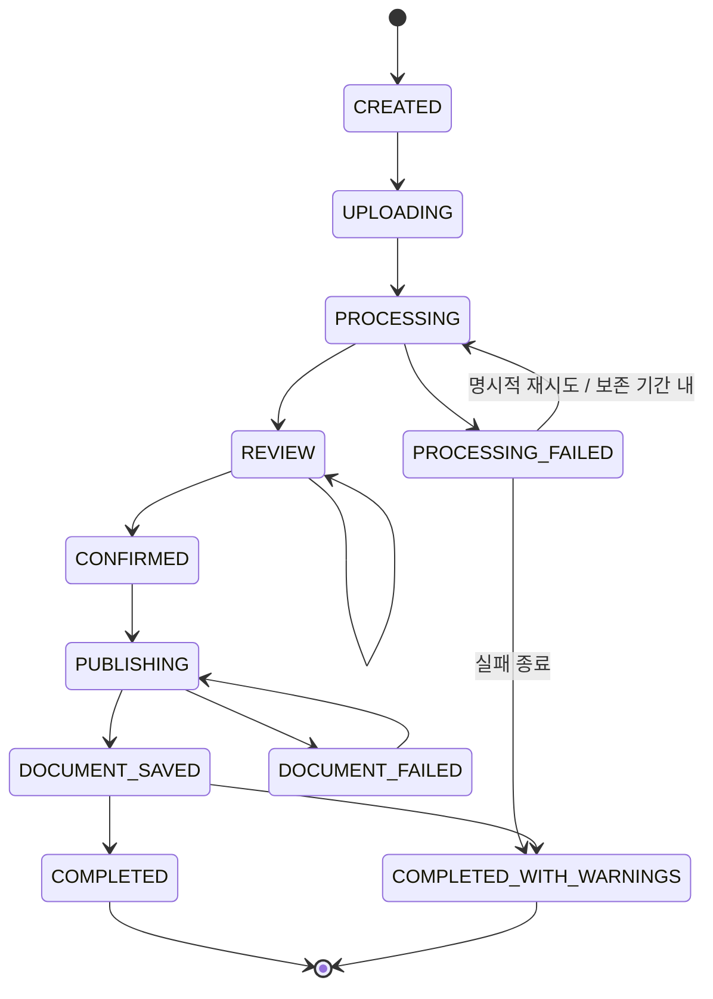
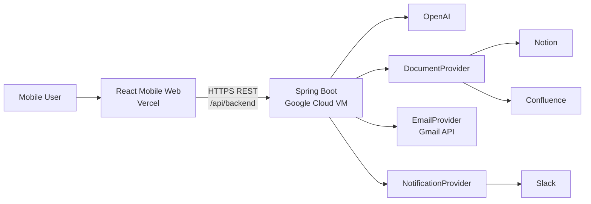
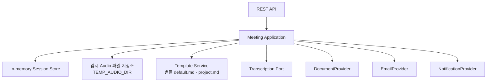
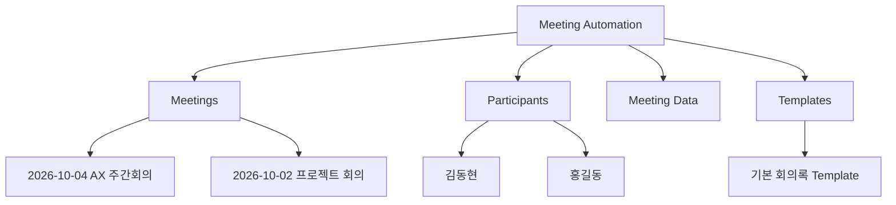

# Meeting Automation Product Requirements Document

> **리뉴얼 안내:** 서비스 정의, 기술 기준, 데이터·연동·API 계약은 현재 구현(코드) 기준으로 정리했다. 화면 설계(`SCR-*`)와 디자인 시스템 절은 **현행 UI 기록**이며 리뉴얼에서 새로 정의한다. Backend와 데이터 저장 구조는 변경하지 않는 고정 계약이고, Backend는 Google Cloud에 배포된 인스턴스를 기준으로 한다. 실제 동작과 운영 설정은 [현재 구현 기준](./implementation-status.md)을 함께 본다. 리뉴얼 진행 기준은 [리뉴얼 준비](../renewal/README.md)를 따른다.

> **문서 ID:** PRD-MA-001\
> **버전:** 2.2.0\
> **기준일:** 2026-11-05\
> **상태:** 현재 구현 기준 정리본 (리뉴얼 계획 수립 전)\
> **문서 역할:** Meeting Automation의 서비스 정의와 제품 요구사항\
> **대상:** Product Owner, Frontend, Backend, QA\
> **기술 기준:** Node.js 24 / React Mobile-first Web / Vercel, Java 25 / Spring Boot 4.1.x / Google Cloud Compute Engine VM\
> **운영 전제:** 단일 회사, 누적 회의 100개 미만

## 구현 상세 문서

- [현재 구현 기준](./implementation-status.md): 저장소 코드에서 확인한 실제 동작
- [Architecture](./architecture.md): 시스템 경계, 구성요소, 흐름, 운영 설계
- [Data Specification](./data-spec.md): 표준 모델, 저장 위치, 수명주기
- [API Specification](./api-spec.md): Frontend/Backend REST 계약
- [Integrations](./integrations.md): 외부 Provider Port와 Adapter 계약
- [문서 연결·이전 설계](./document-setup.md): 전역 설정, 최초 위저드, 구조 생성, 서비스 변경과 자료 이전
- [UI Design](./ui-design.md): 현행 화면·컴포넌트 명세 (리뉴얼 대상)
- [리뉴얼 준비](../renewal/README.md): 리뉴얼 제약과 진행 기준

개발 PC 설정 순서는 [Frontend Setup](../setup/frontend-setup.md)과 [Backend Setup](../setup/backend-setup.md)을 따른다.

> **변경 이력 v2.2.0 (2026-11-05):** 과거 TASK 일정·진행 현황·추적표와 깨진 링크를 제거하고, 서비스 정의·기술 기준·데이터·Provider·API 절을 현재 구현에 맞춤. Render 배포 기준을 Google Cloud 기준으로 변경.

------------------------------------------------------------------------

## 문서 운영 원칙

이 문서는 Meeting Automation의 제품 요구사항 기준이다. 작업 시작 전에 관련 `DEC-*`, `FR-*`, `NFR-*`, `SCR-*`, `API-*`를 확인한다. 설계를 바꿀 때는 먼저 이 PRD의 관련 ID를 갱신한다. 현재 구현은 녹음 처리 직후 Minutes 초안을 만들고, 사용자가 화자와 Minutes를 검토한 뒤 Confirm/Publish로 문서를 저장하며, 저장 뒤 설정된 이메일과 Slack 전달을 처리한다.

### ID 체계

  Prefix     의미
  ---------- ----------------------------------
  `DEC-*`    변경 통제가 필요한 확정 의사결정
  `FR-*`     기능 요구사항
  `NFR-*`    비기능 요구사항
  `SCR-*`    화면
  `API-*`    Backend REST API
  `EXT-*`    외부 Provider 연동 계약
  `ERR-*`    표준 오류

작업 단위(Phase)와 작업 추적은 리뉴얼 계획에서 새로 정의한다. 이 문서는 요구사항과 계약만 기록한다.

------------------------------------------------------------------------

# 서비스 정의

Meeting Automation은 **문서 서비스에 연결한 뒤 회의를 녹음하고, 한국어 전사와 화자 구분을 바탕으로 회의록 초안을 만들어 사용자가 검토·수정한 뒤, 선택한 템플릿의 문서로 저장하고 설정된 이메일·Slack으로 전달하는 내부 서비스**다.

범용 Meeting Intelligence 플랫폼을 목표로 하지 않는다. 핵심 사용 경험은
다음과 같다.

> **문서 서비스와 참석자를 설정 → 회의 정보·템플릿 선택 → 녹음 → 전사·회의록 초안 생성 → 화자 매핑·회의록 검토 및 수정 → 검토 완료 → 템플릿 문서 저장 → 연결된 이메일·Slack 전달**

## 목표

1.  오프라인 회의 기록을 최소 조작으로 시작한다.
2.  녹음 종료 후 STT, Speaker Diarization, 회의록 생성을 자동화한다.
3.  자동 실명 음성 인식 대신 사용자가 `Speaker A/B/C`를 회의 참석자에 매핑한다.
4.  선택한 Template(기본 회의록 또는 프로젝트 회의)과 전사 결과로 구조화 회의록 초안을 자동 생성하고 사용자가 내용을 수정할 수 있게 한다.
5.  사용자가 검토를 완료하면 선택 Template 기준으로 최종 문서를 만들고 Notion 또는 Confluence에 저장한다.
6.  문서 저장에 성공하면 연결된 Gmail과 Slack 알림을 개별적으로 처리한다.
7.  최초 연결 시 Meetings, Participants, Meeting Data, Templates 기본 Page를 준비한다.
8.  앱 첫 방문은 설정 gate를 제공하고, 초기화 완료 후 새 회의 화면으로 이동한다. 이후 방문은 Home에서 새 회의와 최근 회의를 제공한다.
9.  별도 애플리케이션 DB 없이 문서 Provider를 참석자·Template·완료 회의 문서의 영속 저장소로 사용한다.
10. Document와 Email Provider는 공통 계약을 통해 교체 가능하게 한다.

## 비목표

-   실시간 자막
-   Google Meet/Teams/Zoom Bot
-   Calendar 연동
-   자동 실명 화자 인식/Voiceprint
-   네이티브 iOS/Android 앱
-   멀티테넌시
-   사용자별 Integration
-   100개 이상 회의 확장 설계
-   검색 인덱스
-   애플리케이션 DB/JPA/Redis/Queue/Batch
-   과거 회의록의 앱 내부 편집
-   음성 원본 장기 보관
-   Notion Database/Data Source 종속 기능
-   복잡한 관리자 Dashboard

------------------------------------------------------------------------


# Technology Baseline

이 절은 개발 주체가 프로젝트 생성·의존성 선택·빌드 도구를 임의 변경하지 않도록 하는 **개발 기술 기준선**이다.

## Monorepo

하나의 Repository에서 Frontend, Backend, 문서를 함께 관리한다.

```text
meeting-automation/
├─ frontend/                 # React Mobile-first Web (Vite, Vitest, Playwright)
├─ backend/                  # Spring Boot REST API / Integration Backend (Gradle)
├─ scripts/
│  ├─ deploy/                # Google Cloud VM 배포 스크립트·compose 구성
│  └─ verify-secret-boundary.mjs
├─ docs/
│  ├─ product/               # PRD, API·데이터·연동·아키텍처 설계
│  ├─ setup/                 # 개발·배포·테스트 안내
│  └─ renewal/               # 리뉴얼 준비
├─ Dockerfile                # Backend 이미지 빌드
└─ README.md
```

Monorepo는 소스와 개발 기준을 한 Repository에서 관리하기 위한 방식이다. Frontend와 Backend의 빌드 및 배포 단위는 서로 독립적이다.

## Frontend Baseline

| 항목 | 기준 |
|---|---|
| Runtime / Build | Node.js 24 LTS |
| Package Manager | npm |
| UI | React 19 |
| Language | TypeScript 5.x |
| Build Tool | Vite 7.x |
| Routing | React Router |
| Lint | ESLint |
| Unit/Component Test | Vitest |
| Deployment | Vercel |

**Node.js는 업무 Backend가 아니다.** Node.js는 React/Vite의 개발·빌드 Toolchain으로 사용한다. 회의 업무 API, 오디오 chunk 수신·검증·조립, OpenAI, Document, Email, Slack 연동은 Spring Boot Backend가 담당한다. Frontend는 Backend API로 오디오 조각을 직접 전송하며 저장소 credential을 보유하지 않는다.

## Backend Baseline

| 항목 | 기준 |
|---|---|
| Language | Java 25 |
| Framework | Spring Boot 4.1.x |
| Build | Gradle 9.x (JDK 25 실행 기준 최소 9.1) |
| REST | Spring Web |
| Validation | Jakarta Bean Validation / Spring Validation |
| Health | Spring Boot Actuator |
| External HTTP | Spring RestClient 또는 Apache HttpClient5 |
| Test | JUnit 5 |
| Deployment | Google Cloud Compute Engine VM (Docker 이미지, Artifact Registry) |
| Database | 없음 |
| JPA | 사용하지 않음 |
| Redis | 사용하지 않음 |
| Queue/Message Broker | 사용하지 않음 |

외부 HTTP Client는 Adapter별로 난립시키지 않는다. 프로젝트 초기 설정에서 `Spring RestClient` 또는 `Apache HttpClient5` 중 하나를 기본 방식으로 선택하고 이후 동일 기준을 유지한다.

## Runtime 역할



핵심 실행 구조는 다음과 같다.

```text
Browser
  ↓
React / TypeScript
  ↓ HTTPS REST
Spring Boot 4.1.x / Java 25
  ├─ OpenAI
  ├─ Notion / Confluence
  ├─ Email
  └─ Slack
```

## 버전 운영 규칙

- 위 Major 기준을 개발 주체가 임의로 변경하지 않는다.
- 고정 minor가 있는 `4.1.x` 항목은 해당 minor 라인의 호환 가능한 최신 patch를 선택한다. Java 25로 Gradle을 실행할 때는 Gradle 9.1 이상을 사용한다.
- Frontend Node 버전은 `frontend/.nvmrc`를 선택 기준으로 하고 `frontend/package.json`의 `engines.node` 및 `frontend/.npmrc`의 strict 검사와 일치시킨다. 기준 변경 시 PRD와 설치 문서를 같은 변경에서 갱신한다.
- Major 변경은 PRD 또는 ADR 승인 후 진행한다.
- Frontend와 Backend는 Monorepo에 있지만 독립적으로 build/test/deploy 가능해야 한다.

# 확정 의사결정

  -----------------------------------------------------------------------
  ID                                  결정
  ----------------------------------- -----------------------------------
  `DEC-001`                           V1은 단일 회사 서비스다.

  `DEC-002`                           누적 회의는 100개 미만으로 고정
                                      가정하며 규모 확장을 설계하지
                                      않는다.

  `DEC-003`                           Frontend는 React Mobile-first Web을
                                      Vercel에 배포한다.

  `DEC-004`                           Backend는 Java 25 / Spring Boot 4.1.x를
                                      Google Cloud Compute Engine VM에 Docker로 배포한다.

  `DEC-005`                           V1은 DB, JPA, Redis, Queue, Batch를
                                      사용하지 않는다.

  `DEC-006`                           Notion 또는 Confluence 중 하나가
                                      참가자·Template·회의록의 Source of Truth다. 연결과
                                      초기화 전에는 회의 생성이 차단된다.

  `DEC-007`                           스마트폰을 회의 테이블 중앙에 두고
                                      브라우저 마이크로 녹음한다.

  `DEC-008`                           STT 후 Speaker Diarization을 수행해
                                      `Speaker A/B/C...`를 얻는다.

  `DEC-009`                           자동 음성 지문 인식은 하지 않는다.
                                      사용자가 현재 회의의 Speaker를 참석자에
                                      매핑한다. 이전 회의 매핑 저장은 현재 구현이 아니다.

  `DEC-010`                           Speaker mapping은 해당 Speaker의
                                      Transcript 전체에 일괄 적용한다.
                                      Segment마다 사람을 수동 지정하는
                                      UX는 금지한다.

  `DEC-011`                           Template 변경 시 STT를 다시
                                      실행하지 않고 기존 Transcript로
                                      Minutes만 재생성한다.

  `DEC-012`                           Backend에 번들된 default.md와 project.md가
                                      회의록 생성 시 Template의 기준이다. 연결 시
                                      활성 Provider의 Templates page에는 기본
                                      Template을 기록(seed)한다.

  `DEC-013`                           Root `Meeting Automation` 아래
                                      Meetings, Participants, Meeting Data,
                                      Templates page를 준비한다.

  `DEC-014`                           Notion/Confluence 공통화를 위해
                                      Page hierarchy/basic CRUD를
                                      기준으로 한다.

  `DEC-015`                           사용자가 검토를 완료하고 문서 저장에
                                      성공하면 선택한 Email 및 Slack 채널에
                                      각각 전달한다.

  `DEC-016`                           과거 회의는 앱에서 읽기 전용이며
                                      수정은 원문 Document Provider에서
                                      한다.

  `DEC-017`                           Provider Secret은 Backend API에서만 사용한다.
                                      브라우저 localStorage에는 Backend 설정 복구용
                                      Secret 사본이 보관될 수 있다.

  `DEC-018`                           오류는 PROCESSING, DOCUMENT, EMAIL,
                                      NOTIFICATION 네 종류로 운영
                                      분류한다.

  `DEC-019`                           Slack Admin 오류 알림은 V1 핵심
                                      회의 흐름의 필수 조건이 아니다.

  `DEC-020`                           원본 Audio는 Backend 임시 파일로 처리한다.
                                      회의록 초안 생성 성공 후 삭제하고,
                                      실패 시 재시도 정책에 따라 제한 시간 보존한다.
  -----------------------------------------------------------------------

------------------------------------------------------------------------


## 🧭 전역 연결 설정 결정

| ID | 결정 |
|---|---|
| DEC-021 | 제품 계정·로그인·사용자별 설정은 없다. 문서 연결 설정 하나를 서비스 전체가 공유한다. |
| DEC-022 | 활성 설정이 없으면 최초 위저드로 유도하며, 연결 테스트와 명시적 완료 요청으로 기본 Page 구조를 생성·재사용한다. |
| DEC-023 | 운영 중 같은 위저드로 Provider를 변경한다. 전체 자료 복사 또는 새 시작을 선택하며 검증 전 active는 변경하지 않는다. |
| DEC-024 | Backend는 `DOCUMENT_SETTINGS_DIR`과 `DOCUMENT_SETTINGS_ENCRYPTION_KEY`가 구성되면 AES-GCM 암호화 파일에 연결 설정을 저장하고, 구성되지 않으면 프로세스 메모리를 사용한다. Google Cloud 배포는 암호화 키 설정을 필수로 검사한다. 브라우저 localStorage에는 설정 복구용 연결 정보가 보관될 수 있다. 업무 문서는 Provider 정본이고 제품 계정 DB는 없다. |
| DEC-025 | 활성 연결이나 기본 Page 준비가 없으면 설정 화면으로 보내고 회의 기능을 막는다. 저장소 장애나 기존 Provider의 일시 장애를 미설정으로 처리하지 않는다. |
| DEC-026 | 초기화 성공 직후 첫 방문은 New Meeting으로 이동한다. 설정된 이후 재방문은 Home에서 New Meeting과 Meetings history를 제공한다. |
| DEC-027 | 오디오 처리에서 Minutes 초안을 생성한 뒤 사용자가 화자와 참석자를 매핑하고 회의록 내용을 검토·수정한다. |
| DEC-028 | 사용자가 검토를 완료하면 Publish가 선택 Template 및 검토 Minutes로 문서 본문을 생성·저장한다. 저장이 성공한 뒤 설정된 Email/Slack을 전달한다. |
| DEC-029 | 화자 매핑은 현재 Session에서 관리한다. 현재 구현에는 Speaker Memory page나 회의 간 매핑 후보가 없다. |

## 🧩 연결과 이전 요구사항

| ID | 요구사항 |
|---|---|
| FR-031 | Notion/Confluence별 가이드·필수 입력·읽기 전용 테스트·초기 생성 위저드를 제공한다. |
| FR-032 | Settings에서 서비스 전체 연결을 다시 설정하고 동시 Session/쓰기와 전환 충돌을 차단한다. |
| FR-033 | 이전 선택 시 회의록·Transcript·참석자를 참조 무결성과 함께 복사하고 원본을 보존한다. |
| FR-034 | 설정·이전 상태를 재시작 후 복원하고 실패 재개·취소·멱등 생성·검증 후 원자 전환을 지원한다. |
| FR-035 | 앱 진입 상태를 미설정·초기화·준비·저장소 오류·기존 연동 장애로 구분하고, READY 이전에는 회의 기능을 gate한다. |
| FR-036 | 최초 연결 완료 때 Meetings, Participants, Meeting Data, Templates Page를 idempotent하게 생성·재사용하고, 초기화 완료 직후 새 회의 화면으로 이동한다. |
| FR-037 | 연결 시 기본 Template을 Provider Templates page에 기록한다. 회의록 생성에는 Backend 번들 Template(default.md, project.md)을 사용한다. |
| FR-038 | diarization과 Minutes 초안 생성 뒤 Speaker mapping을 저장하고, 사용자가 Minutes를 검토·수정할 수 있다. |
| FR-039 | 검토 완료 후 최종 문서 저장이 성공하면 요청에서 선택한 이메일 수신자와 Notification 채널을 처리하고 각 delivery 결과를 기록한다. |

화면 SCR-013은 공용 연결 위저드, SCR-014는 서비스 전환·자료 이전 진행이다. 신규 API-023~030과 기존 API의 연결 gate는 [API 명세](./api-spec.md)를 따른다. 이 변경의 상세 경계는 [전역 문서 연결 설계](./document-setup.md)가 기준이다.

# 사용자와 핵심 시나리오

## 사용자

### 회의 진행자

-   최초 연결 화면에서 문서 서비스를 설정하고 기본 Page 구성을 완료
-   새 회의 생성과 참가자 이메일 확인
-   녹음
-   Speaker와 참가자 매핑 확인
-   자동 생성된 회의록과 수신자별 이메일 결과 확인
-   필요 시 이전 회의록과 참가자 목록 조회/관리

### 참석자

-   Email로 회의록 결과 수신
-   문서 링크 열람
-   필요 시 Slack 알림 확인

### 운영 관리자

-   회사 단일 Integration 설정
-   Participants 관리
-   Provider 연결 상태 확인
-   Admin Slack 오류 수신

------------------------------------------------------------------------

# 서비스 프로세스

## 사용자 흐름



## 처리 시퀀스



## 세션 상태



녹음 중에는 세션 상태가 `CREATED`이며 첫 chunk 업로드 시 `UPLOADING`이 된다. 이메일·Slack 전달 결과는 별도 상태 없이 Delivery 목록에 기록하고, 모두 성공하면 `COMPLETED`, 일부 실패가 있으면 `COMPLETED_WITH_WARNINGS`가 된다.

------------------------------------------------------------------------

# 시스템 아키텍처

## System Context



## Backend 책임

Backend는 범용 파일 저장 서버가 아니라 **Integration Gateway + Meeting Workflow Processor**다. Audio 처리 입력과 실패 복구를 위해 제한된 기간 동안만 임시 파일을 사용한다.



## Repository 구조

``` text
meeting-automation/
├─ frontend/
│  ├─ src/                    # 화면(*Page.tsx), API 클라이언트(*Api.ts), 녹음·업로드 모듈
│  ├─ e2e/                    # Playwright
│  └─ public/
│
├─ backend/
│  ├─ src/main/java/com/meetingautomation/
│  │  ├─ api/                 # REST Controller, 세션·오디오·처리 서비스
│  │  ├─ transcription/       # OpenAI 전사 Adapter
│  │  ├─ minutes/             # 구조화 회의록·문서 본문 생성
│  │  ├─ document/            # Notion·Confluence Adapter, 초기 구조, 설정, 자료 이전
│  │  ├─ email/               # Gmail Adapter
│  │  └─ notification/        # Slack Adapter
│  └─ src/main/resources/templates/   # default.md, project.md
│
└─ docs/
```

외부 API 모델은 Adapter 내부에서 서비스 DTO로 변환한다.

------------------------------------------------------------------------

# 데이터 구조

## 저장 위치

| 데이터 | 현재 저장 위치 | 지속성 |
|---|---|---|
| 문서·이메일·Slack 연결 설정 | Backend: `DOCUMENT_SETTINGS_DIR`+암호화 키 구성 시 AES-GCM 암호화 파일, 아니면 프로세스 메모리. 브라우저 `localStorage` 복구본 | 파일 저장소 구성 시 재시작 후 유지. 브라우저 복구본은 기기별, 중앙 동기화 없음 |
| OpenAI 설정 | Backend 환경 설정 | 배포 설정에 따름 |
| 참석자·완료 Meeting | Notion 또는 Confluence | Provider 정책에 따름 |
| 회의록 Template | Backend 번들(default.md, project.md). 연결 시 Provider Templates page에 기본 Template 기록 | 배포 산출물에 포함 |
| 화자 매핑·진행 중 MeetingSession | Backend 메모리 | 재시작 뒤 복구 보장 없음 |
| Audio chunk·조립본 | 브라우저 대기 저장소(IndexedDB)와 Backend `TEMP_AUDIO_DIR` 임시 파일 | 초안 생성 성공 후 삭제, 실패 시 24시간 임시 보존 |
| Meeting list cache | Backend 메모리 | 재조회 가능 |

브라우저 복구 정보에는 Provider 자격 증명이 포함될 수 있다. 브라우저 `localStorage`는 암호화된 비밀 저장소가 아니며 브라우저 프로필과 기기에 한정된다.

## MeetingSession

MeetingSession은 `sessionId`, `version`, `status`, `meeting`(제목·날짜·참가자·Template), `speakers`(화자-참가자 매핑), `transcript`(발화 segment), `minutes`(요약·논의·결정·실행 항목·후속 조치), `document`(저장 결과), `deliveries`(채널별 전달 결과)로 구성된다. 필드 단위의 표준 모델과 API 응답 형태는 [Data Specification](./data-spec.md)과 [API Specification](./api-spec.md)을 따른다.

### 핵심 규칙

-   Transcript에는 `speakerId`를 보존한다.
-   사람 이름은 `speakerId → participantId` mapping으로 해석한다.
-   mapping 변경 시 모든 해당 segment가 즉시 같은 사람으로 표시된다.
-   Template 재생성은 `transcript`와 `speaker mapping`을 입력으로
    사용한다.
-   Template 재생성 시 Audio/STT는 호출하지 않는다.

------------------------------------------------------------------------

# Document 구조

## 논리 구조



Bootstrap은 Root `Meeting Automation` 아래에 `Meetings`, `Participants`, `Meeting Data`, `Templates`를 만든다. Notion은 `Meeting Data` 아래에 `Meeting Index` page를 추가로 만든다. `Service Info`, `History`, `Processing History` 등 그 밖의 page는 자동 생성하지 않는다. Home과 history 목록은 앱 UI이며 Provider page가 아니다.

## Meeting Document

``` text
2026-10-04 AX 주간회의

회의 정보
- 일시
- 참석자

회의 요약

주요 논의사항

결정사항

Action Items

후속 확인사항

Transcript
```

변환 실패로 마무리한 Meeting 문서는 일반 Minutes 대신 다음 기록을 저장한다.

``` text
회의 정보
- 일시
- 참석자

녹음 변환 결과: 실패
- 실패 단계
- 원본 Audio 처리: 다운로드 완료 또는 다운로드하지 않음
- 종료 시각
```

참석자에게 실패 기록을 Email/Slack으로 전달하지 않는다. Provider가 허용하는 최소 metadata에 실패 stage, safe error code, Audio disposition을 추가한다. 원본 오류 문구, Audio, Transcript, Secret은 저장하지 않는다.

Machine-readable metadata는 Provider가 허용하는 최소 속성/metadata를
사용한다.

필수 metadata:

``` json
{
  "schemaVersion": "1.0",
  "externalSessionId": "ms_xxx",
  "meetingAt": "2026-10-04T10:00:00+09:00",
  "templateId": "default.md",
  "participantIds": ["pt_001", "pt_002"]
}
```

## Participant

V1 Participant는 다음만 가진다.

``` json
{
  "id": "pt_001",
  "name": "김동현",
  "email": "user@example.com"
}
```

부서, 직급, Slack ID, Voiceprint, Meeting History는 저장하지 않는다.

------------------------------------------------------------------------

# Provider 공통 계약

## DocumentProvider

``` text
validateConnection()
discoverStructure(rootId)
listMeetings(max=100)
getMeeting(documentId)
findMeetingBySessionId(sessionId)
createMeeting(command)
listParticipants()
createParticipant(command)
updateParticipant(participantId, command)
```

Provider-specific 기능을 Domain 요구사항으로 올리지 않는다.

### Notion

-   Page hierarchy
-   child page list/read/create/update
-   basic page metadata
-   Notion Database/Data Source 의존 금지

### Confluence

-   Parent/child Page hierarchy
-   child page list/read/create/update
-   basic content property/metadata

## EmailProvider

``` text
validateConnection()
sendTestMessage()
sendMeetingEmail(command)
```

Email은 참석자별 Delivery다. 현재 Adapter는 Gmail API(OAuth 2.0)다.

## NotificationProvider

``` text
validateConnection()
sendMeetingPublished(command)
```

운영 오류 알림(Admin incident)은 NotificationProvider와 별도의 `AdminIncidentNotifier`가 담당하며 Slack Webhook Adapter로 구현한다. Slack은 첫 구현 Adapter일 뿐 Domain 명칭이 아니다.

## TranscriptionProvider

``` text
transcribeWithDiarization(audio)
```

표준 출력:

``` json
{
  "speakers": [
    {"speakerId": "speaker_a", "label": "Speaker A"},
    {"speakerId": "speaker_b", "label": "Speaker B"}
  ],
  "segments": [
    {
      "segmentId": "seg_001",
      "speakerId": "speaker_a",
      "startMs": 0,
      "endMs": 4200,
      "text": "..."
    }
  ]
}
```

OpenAI 모델명은 PRD의 영구 계약으로 고정하지 않고 Backend 설정(`TRANSCRIPTION_MODEL`, `MINUTES_MODEL`)으로 선택한다. 현재 기본값은 전사 `gpt-4o-transcribe-diarize`(`diarized_json` 응답), 회의록 `gpt-6-luna`다.

------------------------------------------------------------------------

# Template

## default.md

필수 섹션:

-   회의 정보
-   회의 요약
-   주요 논의사항
-   결정사항
-   Action Items
-   후속 확인사항
-   Transcript

## project.md

필수 섹션:

-   프로젝트/회의 목적
-   진행 현황
-   주요 논의사항
-   이슈/위험
-   결정사항
-   Action Items
-   다음 단계
-   Transcript

회의록 초안 단계에서 LLM은 Markdown 문자열이 아니라 구조화 Minutes(JSON Schema 응답)를 반환한다. 문서 저장 단계에서는 선택 Template과 사용자가 검토한 Minutes를 문서 작성 모델에 전달해 Template의 제목·섹션 순서를 따르는 Markdown 본문을 생성한다. Template은 Backend 번들 default.md와 project.md 두 종류이며 `GET /api/v1/templates`가 목록을 제공한다.

각 생성 claim은 근거가 되는 Transcript segment를 가리켜야 한다. Backend는 인용 segment ID의 입력 존재를 검증하며 의미적 함의까지 독립 입증하지 않는다. 근거가 확인되지 않는 summary/list claim은 해당 claim만 제거하고, Action task가 지원되지 않으면 그 Action item을 제거한다. 지원되는 task의 날짜는 canonical ISO literal이 인용 segment 본문에 있을 때만 유지하며 담당자와 나머지 날짜 근거가 없으면 각각 null로 둔다. 구조/schema 오류는 별도의 처리 실패로 보존한다.

------------------------------------------------------------------------

# 기능 요구사항

  -----------------------------------------------------------------------
  ID                                  요구사항
  ----------------------------------- -----------------------------------
  `FR-001`                            Home에서 새 회의와 최근 회의 최대
                                      3건을 제공한다.

  `FR-002`                            회의명, Template, 참석자를 선택해
                                      MeetingSession을 생성한다.

  `FR-003`                            스마트폰 브라우저 마이크 권한을
                                      확인하고 녹음한다.

  `FR-004`                            녹음 중 경과시간과 상태, 종료
                                      버튼을 제공한다.

  `FR-005`                            종료 전 확인 Modal을 제공한다.

  `FR-006`                            Audio를 chunk 단위로 임시
                                      보관/업로드한다.

  `FR-007`                            녹음 종료 후 STT + Speaker
                                      Diarization을 수행한다.

  `FR-008`                            Processing 상태를 단계별 표시한다.

  `FR-009`                            Transcript를 기반으로 Template별
                                      Minutes 초안을 생성한다.

  `FR-010`                            감지된 Speaker A/B/C를 선택된
                                      참석자와 dropdown으로 매핑한다.

  `FR-011`                            Speaker mapping을 해당 speaker의
                                      Transcript 전체에 적용한다.

  `FR-012`                            사용자가 Minutes를 검토/수정한다.

  `FR-013`                            Template을 변경하고 기존
                                      Transcript로 Minutes를 재생성한다.

  `FR-014`                            재생성 시 STT를 다시 실행하지
                                      않는다.

  `FR-015`                            Transcript 원문을 별도
                                      Sheet/Drawer로 조회한다.

  `FR-016`                            확정 Minutes를 Document Provider에
                                      저장한다.

  `FR-017`                            Email 수신자를 확인/선택하고
                                      발송한다.

  `FR-018`                            Document 저장 후 Slack 알림을
                                      보낸다.

  `FR-019`                            Document/Email/Notification 결과를
                                      독립적으로 표시한다.

  `FR-020`                            Meetings child를 조회하여 과거 회의
                                      목록을 제공한다.

  `FR-021`                            100개 미만 목록을 브라우저에서
                                      제목/참석자로 필터링한다.

  `FR-022`                            과거 회의 상세를 앱에서 읽기
                                      전용으로 표시한다.

  `FR-023`                            원문 Notion/Confluence 열기 기능을
                                      제공한다.

  `FR-024`                            Participants를
                                      조회/추가/수정/삭제한다.

  `FR-025`                            초기 완료 시 Root/Meetings/Participants/
                                      Meeting Data/Templates를 생성·재사용하고 업무 요청에서는 탐색한다.

  `FR-026`                            Provider 연결 상태와 전역 설정을 확인하고
                                      동일 위저드로 재설정한다.

  `FR-027`                            사용자가 retryable 처리 실패를 24시간 안에 명시 재시도하거나 Audio 다운로드 후 실패 마무리를 선택한다. 자동 재시도는 없다.

  `FR-028`                            처리 성공 시 Audio를 삭제하고, 변환 실패에서는 Backend 임시 파일로 다운로드·실패 종료 기회를 위해 최대 24시간 보존 후 삭제한다.

  `FR-029`                            운영 오류를 Admin Slack으로
                                      전송한다.

  `FR-030`                            저장된 Secret은 Frontend/API 응답에
                                      노출하지 않는다.
  -----------------------------------------------------------------------

------------------------------------------------------------------------

# 비기능 요구사항

  -----------------------------------------------------------------------
  ID                                  요구사항
  ----------------------------------- -----------------------------------
  `NFR-001`                           Mobile-first, 360px 이상 주요
                                      모바일 폭에서 가로 스크롤이 없어야
                                      한다.

  `NFR-002`                           주요 Touch Target은 최소 44×44 CSS
                                      px를 확보한다.

  `NFR-003`                           Android Chrome, iOS Safari를 우선
                                      지원한다.

  `NFR-004`                           HTTPS를 사용하고
                                      Secret/Audio/Transcript를 일반
                                      로그에 기록하지 않는다.

  `NFR-005`                           Provider Secret은 Backend에서만
                                      사용한다.

  `NFR-006`                           Audio는 처리 목적의 임시 데이터이며 영구 보관하지 않는다. 변환 실패 Audio는 Backend 임시 파일(`TEMP_AUDIO_DIR`)로 마지막 실패부터 최대 24시간 보존한다. 사용자 retry 실행 중에는 처리 입력으로 유지한다. Backend API로만 읽고 공개 URL을 만들지 않으며 성공·사용자 종료·만료 후 삭제한다. 사용자 계정 인증은 현재 API 계약에 포함하지 않는다.

  `NFR-007`                           네트워크 일시 단절 시 미전송
                                      chunk를 재전송할 수 있어야 한다.

  `NFR-008`                           외부 연동은 Provider 공통 계약 뒤에
                                      둔다.

  `NFR-009`                           DB/JPA/Redis/Queue 없이 Backend 한
                                      서비스로 운영 가능해야 한다.

  `NFR-010`                           비동기 처리 중 UI를 Block하지 않고
                                      상태를 표시한다.

  `NFR-011`                           동일 Publish 재요청으로 중복 문서를
                                      만들지 않는다.

  `NFR-012`                           접근성 상태는 색상만으로 표현하지
                                      않는다.

  `NFR-013`                           모든 시간 API 값은 ISO 8601을
                                      사용한다.

  `NFR-014`                           처리 단계별 traceId/sessionId를
                                      구조화 로그에 남긴다.
  -----------------------------------------------------------------------

------------------------------------------------------------------------

> **리뉴얼 대상:** 아래 Information Architecture, 화면 설계, 디자인 시스템은 현행 UI 기록이다. 리뉴얼에서 화면 구성과 UX를 새로 정의하므로 현재 코드와의 세부 차이는 이 단계에서 맞추지 않는다.

# Information Architecture

``` text
Meeting Automation
├─ Home
│  └─ New Meeting
│      ├─ Recording
│      ├─ Processing
│      ├─ Review
│      ├─ Share
│      └─ Complete
│
├─ Meetings
│  └─ Meeting Detail
│
└─ Settings
   ├─ Company / Integrations
   └─ Participants
```

Bottom Navigation:

``` text
[ Home ]     [ Meetings ]     [ Settings ]
```

Recording/Processing 중 Bottom Navigation은 숨긴다.

------------------------------------------------------------------------

# 화면 설계

## SCR-001 Home

**목적:** 앱 진입 즉시 회의를 시작하거나 최근 회의를 확인한다.

**구성** - App title - `새 회의` Primary Button - 최근 회의 최대 3건 -
전체 보기 - Bottom Navigation

``` text
┌──────────────────────────┐
│ 회의 시작                 │
│                          │
│  회의를 시작할까요?      │
│  회의 내용을 녹음하고    │
│  자동으로 정리합니다.    │
│                          │
│  [ ● 새 회의 시작 ]      │
│                          │
│ 최근 회의                │
│ AX 주간회의              │
│ 오늘 10:30 · 4명         │
│ ──────────────────────── │
│ 프로젝트 진행회의        │
│ 10/02 · 3명              │
│                  전체보기│
├──────────────────────────┤
│ 홈       회의록      설정│
└──────────────────────────┘
```

Primary: 새 회의 시작\
Secondary: 최근 회의 선택 / 전체 보기

------------------------------------------------------------------------

## SCR-002 New Meeting

**목적:** 회의 시작에 필요한 최소 정보를 입력한다.

필드: - 회의명 - Template - 참석자 multi-select - 참석자 추가

Validation: - 회의명 필수 - 참석자 1명 이상 - Template 필수

``` text
← 새 회의

회의명
[ AX 주간회의              ]

회의록 형식
[ 기본 회의록           ▼ ]

참석자
☑ 김동현
☑ 홍길동
☐ 이영희

[ + 참석자 추가 ]

[        회의 시작        ]
```

------------------------------------------------------------------------

## SCR-003 Recording

**목적:** 스마트폰을 테이블 중앙에 놓고 방해 없이 녹음한다.

표시: - 회의명 - Recording indicator - 경과 시간 - `녹음 중` - 큰 종료
버튼

``` text
┌──────────────────────────┐
│                          │
│      AX 주간회의         │
│                          │
│            ●             │
│         00:42:18         │
│          녹음 중         │
│                          │
│                          │
│                          │
│    [ ■ 회의 종료 ]       │
└──────────────────────────┘
```

녹음 중 Navigation을 숨긴다.

------------------------------------------------------------------------

## SCR-004 End Confirm

Bottom Sheet/Modal:

``` text
회의를 종료할까요?

녹음을 종료하고 회의록 작성을
시작합니다.

[ 계속 녹음 ]  [ 회의 종료 ]
```

------------------------------------------------------------------------

## SCR-005 Processing

``` text
회의를 정리하고 있어요

✓ 녹음 업로드
✓ 음성 변환
● 화자 분석
○ 회의록 작성

잠시만 기다려 주세요.
```

실제 Backend 상태와 동기화한다.

`PROCESSING_FAILED`이면 실패 stage와 안전한 안내를 표시한다. `retryable=true`이고 Audio 보존 기한 전이면 사용자가 변환 재시도를 실행할 수 있다. 자동 재시도는 없다. Audio는 Backend 임시 파일에 보존되며 재시작 뒤 보존은 보장하지 않는다. 실패 종료 시 Meeting 문서에는 회의 정보와 변환 실패 정보를 기록하고 Email/Slack은 보내지 않는다.

``` text
녹음 변환에 실패했어요
실패 단계: 음성 변환
원본 녹음은 재시도에 필요한 동안 임시 보관됩니다.

[ 변환 재시도 ]  [ 원본 녹음 다운로드 ]
[ 변환 실패로 마무리 ]
```

재시도 버튼은 API가 retry를 허용할 때만 보인다. 다운로드 후 저장 여부를 확인받고 실패 종료할 수 있다. 만료 뒤에는 재시도/다운로드 action을 숨기고 Session이 남아 있으면 실패 종료 상태와 자동 정리 결과를 표시한다. Backend 재시작으로 Session이 소실된 경우 API는 `SESSION_NOT_FOUND`를 반환한다.

------------------------------------------------------------------------

## SCR-006 Review: Speaker Mapping and Minutes

**목적:** 사용자가 Speaker를 참석자에 매핑하고 자동 생성된 회의록 초안을 검토·수정한다.

우선순위: 1. Speaker mapping 2. Transcript 원문

``` text
← 회의록 확인

AX 주간회의

화자를 확인해주세요

Speaker A
[ 김동현              ▼ ]

Speaker B
[ 이영희              ▼ ]

Speaker C
[ 홍길동              ▼ ]

────────────────────────

[ 원문 대화 보기 ]

[       매칭 완료       ]
```

규칙: 화자 매핑과 회의록 수정은 각각 저장한다. Transcript를 참고해 요약, 논의 내용, 결정 사항과 실행 항목을 검토한다. 변경이 저장되지 않았으면 검토 완료를 막고 사용자에게 저장을 요청한다. 검토 완료 뒤 문서 저장·전달 단계로 이동한다. 별도 Speaker Memory 후보 기능은 현재 없다.

------------------------------------------------------------------------

## SCR-007 Meeting Result

``` text
회의록 전달 결과

문서 저장
Notion
Meeting Automation / Meetings
✓ 준비 완료

이메일 전달 결과
✓ 김동현
  user1@example.com
✓ 홍길동
  user2@example.com

Slack 전달 결과
✓ 전달 완료

Notion 문서 열기
```

이 화면은 검토 완료 후 시작된 문서 작성·저장·전달의 각 단계를 보여준다. 문서 작성 모델은 선택된 Template과 검토 완료 Minutes를 입력으로 사용한다. 저장 성공 뒤 설정된 이메일과 Slack 전달이 개별 진행되고, 성공·실패 원인을 각 단계에 표시한다. 실패한 단계는 제공된 재시도 action으로 다시 시도한다.

Document 저장 실패 시 Email/Slack 전달을 시작하지 않는다. 이메일은 수신자별 결과를 표시하며 성공한 수신자에게 중복 발송하지 않는다.

------------------------------------------------------------------------

## SCR-008 Complete

``` text
        ✓

회의록 저장 및 전달이 완료되었습니다

Notion        저장 완료
Email         전달 완료
Slack         전달 완료

[ 회의록 보기 ]
[ 홈으로 ]
```

부분 실패는 각 채널에 별도 표시한다.

------------------------------------------------------------------------

## SCR-009 Meetings

``` text
회의록

[ 회의 검색             ]

2026년 10월

AX 주간회의
10/04 · 김동현 외 3명
────────────────────────

프로젝트 진행회의
10/02 · 홍길동 외 2명

2026년 9월
...
```

Provider에서 최대 100개 미만 목록을 가져와 Frontend에서 필터링한다.

------------------------------------------------------------------------

## SCR-010 Meeting Detail

``` text
← 회의록

AX 주간회의
2026.10.04 10:00

참석자
김동현 · 홍길동 · 이영희

회의 요약
...

주요 논의사항
...

결정사항
...

Action Items
...

[ 원문 Transcript 보기 ]

[ Notion에서 열기 ↗ ]
```

앱 내부 수정 기능은 제공하지 않는다.

------------------------------------------------------------------------

## SCR-011 Settings

``` text
설정

회사
SFOOD                     >

문서 저장
Notion · 연결됨           >

Email
연결됨                    >

알림
Slack · 연결됨            >

참석자
18명                      >
```

설정은 서비스 공통이며 제품 계정·로그인·사용자별 환경 설정은 없다. 문서 저장 row에서 연결 또는 변경 위저드를 연다. 입력 중 password 필드 외 저장된 Secret 원문을 표시하지 않는다. 상세는 [문서 연결·이전 설계](./document-setup.md)를 따른다.

------------------------------------------------------------------------

## SCR-012 Participants

기능: - 목록 - 검색 - 추가 - 이름 수정 - Email 수정

필드: - name - email

------------------------------------------------------------------------

# 디자인 시스템

## 디자인 방향

**키워드:** Calm / Minimal / Trustworthy / Mobile Recording / Clear
Review

기업 Dashboard보다 **Voice Recorder + Note App**에 가까운 경험을 만든다.

### 정보 밀도

-   Recording: 매우 낮음
-   Home/New Meeting: 낮음
-   Review/Meeting Detail: 중간
-   Settings: 낮음

## Layout

-   Mobile-first single column
-   Content max-width: 640px
-   좌우 기본 padding: 20px
-   작은 화면 최소 padding: 16px
-   section gap: 24\~32px
-   component gap: 8/12/16px
-   Bottom Primary Action은 safe-area를 고려한다.

## Typography

  Token       용도
  ----------- -----------------
  `Display`   Recording timer
  `Title`     Screen title
  `Heading`   Section heading
  `Body`      기본 본문
  `Label`     Input/status
  `Caption`   보조 정보

폰트 종류는 1개 계열을 기본으로 하고 크기/weight로 계층을 만든다.

## Components

### Primary Button

-   화면의 핵심 행동 하나에만 사용
-   모바일 full width 우선
-   최소 높이 52px

### Secondary Button

-   취소/보조 동작

### Input/Select

-   최소 높이 48px
-   Label은 placeholder로 대체하지 않는다.

### Card

-   최근 회의/상태 그룹에 제한적으로 사용
-   과도한 카드 중첩 금지

### Bottom Sheet

-   종료 확인
-   Transcript
-   참석자 추가 등 모바일 보조 흐름

### Status

-   아이콘 + 텍스트
-   색상만으로 성공/실패 표현 금지

### Recording Indicator

-   `●` + `녹음 중`
-   Timer를 가장 강하게 표시
-   종료 버튼 외 불필요한 액션 제거

## 상태 화면

모든 주요 조회 화면은 다음 상태를 정의한다.

-   Loading
-   Empty
-   Error
-   Ready

Processing은: - Waiting - Running - Completed - Failed

------------------------------------------------------------------------

# 오류 모델

운영 오류는 정확히 네 종류다.

  -----------------------------------------------------------------------
  Type                                포함
  ----------------------------------- -----------------------------------
  `PROCESSING_FAILURE`                Audio upload/assembly, STT,
                                      Diarization, LLM Minutes

  `DOCUMENT_FAILURE`                  Notion/Confluence
                                      discover/read/create

  `EMAIL_FAILURE`                     Email 전송

  `NOTIFICATION_FAILURE`              Slack 등 Notification
  -----------------------------------------------------------------------

Admin Slack에는 다음만 전달한다.

``` json
{
  "incidentType": "PROCESSING_FAILURE",
  "sessionId": "ms_xxx",
  "stage": "TRANSCRIPTION",
  "traceId": "tr_xxx",
  "message": "Transcription failed",
  "retryable": true,
  "occurredAt": "2026-10-04T02:16:00Z"
}
```

Audio, Transcript, Minutes 본문, Token, 전체 Email 주소는 Admin Slack에
포함하지 않는다.

------------------------------------------------------------------------

# Backend REST API

REST API 계약은 중복 관리를 피하기 위해 [API Specification](./api-spec.md)을 단일 기준으로 한다. 요청·응답 필드, 상태 코드, 오류 코드, 헤더 규칙(`Idempotency-Key`, `If-Match`)은 해당 문서를 따른다. 이 PRD의 `API-*` ID는 api-spec의 ID와 같다.
------------------------------------------------------------------------

# 외부 연동 계약

## EXT-001 AI/STT

입력: - assembled audio - MIME type - language hint optional

필수 결과: - text - timestamp segment - stable speaker label per segment

Backend 표준화: - Provider speaker label → internal `speakerId` -
Provider segment → TranscriptSegment

외부 API의 모델명/버전은 배포 설정으로 관리한다.

## EXT-002 Minutes AI

입력:

``` json
{
  "templateId":"default.md",
  "participants":[],
  "speakerMappings":[],
  "transcript":[]
}
```

Provider 내부 출력은 Template별 Structured Minutes claim과 claim별 Transcript segment ID 근거를 포함한다. Backend는 인용 ID의 입력 존재를 확인하지만 claim의 의미적 함의는 별도 검증하지 않는다. 입력 Transcript에서 찾을 수 없는 근거에 해당하는 텍스트 claim만 제거하고, Action task의 canonical ISO date literal이 인용 segment에 없으면 날짜를 null로 정규화한다. 저장 및 API에 노출되는 결과는 [Data Specification](./data-spec.md)의 표준 Structured Minutes DTO이며 evidence ID를 포함하지 않는다.

## EXT-003 Document

공통 capability: - validate root - list children - create child - read
document - update metadata - return URL

Notion/Confluence의 실제 Request/Response는 Adapter 내부 DTO로 격리한다.

## EXT-004 Email

필수 입력: - recipients - subject - meeting summary/body - document URL

수신자별 결과를 독립적으로 반환한다.

## EXT-005 Notification

Meeting notification: - meeting title - meeting date - document URL

Admin incident: - incidentType - sessionId - stage - traceId - safe
error summary

------------------------------------------------------------------------

# Security / Secret

Backend 환경 설정 예:

``` text
APP_COMPANY_ID
APP_COMPANY_NAME
APP_TIMEZONE

DOCUMENT_SETTINGS_DIR
DOCUMENT_SETTINGS_ENCRYPTION_KEY
# 문서 Provider/계정 이메일/API token/부모 경로는 화면 위저드에서 등록

OPENAI_API_KEY
TRANSCRIPTION_MODEL
MINUTES_MODEL

EMAIL_PROVIDER=GMAIL_API
EMAIL_OAUTH_CLIENT_ID
EMAIL_OAUTH_CLIENT_SECRET
EMAIL_OAUTH_REFRESH_TOKEN
EMAIL_SENDER_ADDRESS
# 이메일·Slack 연결은 설정 화면에서도 저장할 수 있으며 저장값이 환경변수보다 우선한다.

NOTIFICATION_PROVIDER
SLACK_MEETING_WEBHOOK_URL
SLACK_ADMIN_WEBHOOK_URL

ALLOWED_ORIGINS
TEMP_AUDIO_DIR
```

기타 조정 가능한 환경변수(전사·회의록 타임아웃, `MAX_CHUNK_BYTES`, `MAX_MEETING_DURATION_MINUTES` 등)는 [Integrations](./integrations.md)와 `backend/src/main/resources/application.yml`을 따른다.

규칙: - 실제 Secret을 Git에 Commit하지 않는다. - Frontend env에는
Backend public URL 외 Provider Secret을 넣지 않는다. - API 응답으로
Secret을 반환하지 않는다. -
Authorization/Webhook/Email/Transcript/Audio는 일반 로그에서 마스킹 또는
제외한다.

------------------------------------------------------------------------

# 실제 모바일·회의실 품질 검증

실제 스마트폰과 회의실 환경의 녹음 품질 검증은 **V1 Release 전에는 수행해야 하지만 초기 개발의 선행조건은 아니다.**

현재 실제 모바일 테스트가 어렵더라도 개발은 다음 자료로 계속 진행한다.

- Browser `MediaRecorder` 구현
- 개발 PC/브라우저에서 생성한 녹음
- Mock audio
- 사전에 준비한 test audio
- 3인/5인 대화를 가정한 diarization test fixture
- Backend audio chunk fixture

즉 다음 구현은 실제 회의실 테스트를 기다리지 않는다.

```text
Meeting UI
→ MediaRecorder
→ Chunk upload
→ Processing API
→ STT integration
→ Speaker Diarization
→ Speaker Mapping
→ Minutes
→ Publish / Delivery
```

실제 환경 테스트는 기능 완성 후 **품질 검증 단계**에서 수행하고 결과에 따라 녹음 MIME, chunk 크기, 마이크 안내, STT 설정, diarization 설정 등을 조정한다.

## 검증 대상

### Android
- Chrome
- 30분
- 60분

### iOS
- Safari
- 30분
- 60분

### 실제 회의실
- 스마트폰 테이블 중앙
- 3명
- 5명

## 검증 항목

- MediaRecorder MIME 호환성
- 30~60분 녹음 지속성
- 화면 잠금/백그라운드 영향
- 앱 전환/전화 수신 영향
- 네트워크 단절
- chunk local persistence
- chunk 재전송
- Backend 업로드 안정성
- AI input compatibility
- STT 품질
- Speaker diarization 품질
- Speaker A/B/C mapping UX
- 회의실 반향/배경소음 영향

## 조정 원칙

품질 문제가 발견되어도 DB, Native App, Object Storage 등 새로운 핵심 아키텍처를 즉시 추가하지 않는다. 현재 구조 안에서 먼저 조정하고, 구조 변경이 필요한 경우 ADR과 PRD 변경으로 결정한다.

# Release Definition of Done

V1 Release는 다음을 모두 만족해야 한다. 실제 모바일/회의실 검증은 초기 개발 Gate가 아니지만 기능 개발 이후 **Release Gate**로 적용한다.

-   [ ] Android Chrome 30\~60분 녹음 검증
-   [ ] iOS Safari 30\~60분 녹음 검증
-   [ ] 실제 회의실 3명 Speaker diarization 검증
-   [ ] 실제 회의실 5명 Speaker diarization 검증
-   [ ] Speaker A/B/C → Participant mapping 검증
-   [ ] Segment별 수동 화자 지정 UX가 존재하지 않음
-   [ ] Template 변경 시 STT 재실행이 없음을 테스트로 검증
-   [ ] default.md/project.md 생성 검증
-   [ ] Notion Page hierarchy 검증
-   [ ] Confluence Page hierarchy 검증
-   [ ] Participants CRUD 검증
-   [ ] Meetings list/detail read-only 검증
-   [ ] Email 전달 검증
-   [ ] Slack Notification 검증
-   [ ] Admin Slack 4종 오류 검증
-   [ ] 최초 연결 위저드와 양방향 Provider 변경·전체 자료 복사 검증
-   [ ] 설정·이전 journal 재시작 복원과 원본 보존 검증
-   [ ] 저장된 Secret의 FE bundle·웹 저장소·조회 API·로그 노출 0건
-   [ ] Audio 영구 보관 0건
-   [ ] DB/JPA/Redis/Queue 의존 0건

------------------------------------------------------------------------

# 변경 통제

다음은 PRD 변경 승인 없이 임의로 바꾸지 않는다.

-   DB 추가
-   JPA/Redis/Queue 추가
-   Notion Database/Data Source 도입
-   자동 실명 화자 인식
-   Speaker diarization 제거
-   Transcript segment마다 사용자에게 화자를 지정시키는 UX
-   Service Info/History 등 추가 문서 계층 생성
-   Template 변경 시 STT 재실행
-   Document 저장 전 Email 발송
-   Provider-specific 기능을 Domain 공통 계약에 침투시키는 설계

새 요구사항은 임의로 구현하지 않고 PRD 변경 대상으로 먼저 정리한다.

------------------------------------------------------------------------

# 최종 제품 기준

Meeting Automation V1의 제품 경험은 다음 한 문장으로 판단한다.

> **최초 문서 연결을 마친 사용자가 스마트폰으로 회의를 녹음하고, AI가 만든 회의록 초안에서 화자를 참가자에 연결하고 내용을 검토하면, 회의록이 문서에 저장된 뒤 설정된 이메일·Slack으로 전달되어야 한다.**

이 기준에 직접 기여하지 않는 기능은 V1에 추가하지 않는다.
