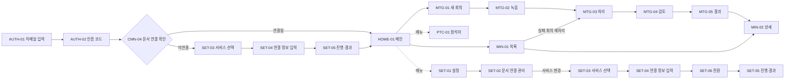

# 리뉴얼 화면 기획 — 전체 화면 목록

| 항목 | 내용 |
|---|---|
| 문서 상태 | 초안 v0.1 (2026-11-05) |
| 기준 | 현재 Frontend 라우트와 화면 컴포넌트(`frontend/src`), 현행 캡처(`docs/renewal/현_UI`) |
| 범위 | 현재 화면 전체 + 신규 로그인(이메일 OTP) 화면 |
| 고정 제약 | [리뉴얼 준비](../README.md) — Backend·저장 구조 변경 어려움, GCE Backend와 Vercel 연결 유지 |

## 1. 리뉴얼 방향

| 구분 | 현행 | 리뉴얼 방향 (제안) |
|---|---|---|
| 화면 기준 | 모바일 기준 단일 컬럼. 데스크톱에서도 하단 탭 바와 늘어난 단일 컬럼으로 표시 | 데스크톱 우선 반응형. 데스크톱은 좌측 사이드바 + 본문, 모바일은 상단 헤더 + 하단 탭 바 |
| 진입 | 누구나 URL로 바로 접근 | 회사 이메일 → 6자리 OTP 확인 후 메인 진입 |
| 품질 | 상태 메시지와 오류가 문장 위주로 나열되고 기술 용어(Provider, Review, Transcript 등)가 노출됨 | 상태는 배지·단계 표시로 구조화하고 용어는 한국어로 통일 |
| 공통 요소 | 화면마다 제목 아이콘·버튼 배치가 제각각 | 공통 레이아웃(CMN-01)과 공통 컴포넌트 기준으로 통일 |

## 2. 화면 ID 체계

`{영역}-{번호}` 형식을 사용한다. 팝업·드로어는 소속 화면 ID 뒤에 `-P{번호}`를 붙인다.

| 영역 코드 | 의미 |
|---|---|
| CMN | 공통 (레이아웃, 오버레이, 오류 페이지, 진입 점검) |
| AUTH | 로그인·인증 (신규) |
| HOME | 메인 |
| MTG | 회의 진행 (생성 → 녹음 → 처리 → 검토 → 결과) |
| MIN | 회의록 조회 (Minutes) |
| PTC | 참석자 관리 (Participants) |
| SET | 설정·문서 연결 |

> 이전 UI 설계 문서(`docs/product/ui-design.md`)의 `SCR-001`~`SCR-012`는 초기 시안 기준이며, 리뉴얼 기획에서는 이 문서의 ID를 사용한다.

## 3. 전체 화면 목록

| 화면 ID | 화면명 | 유형 | 경로 | 현재 구현 | 구분 | 상세 |
|---|---|---|---|---|---|---|
| CMN-01 | 공통 레이아웃 | 레이아웃 | 전체 | `App.tsx` | 현행 개편 | [문서](CMN-01_공통레이아웃.md) |
| CMN-02 | 서버 연결 복구 | 오버레이 | 전체 | `components/BackendRecoveryOverlay.tsx` | 현행 개편 | [문서](CMN-02_서버연결복구.md) |
| CMN-03 | 페이지 없음 | 페이지 | `*` | `App.tsx` `FutureRouteNotice` | 현행 개편 | [문서](CMN-03_페이지없음.md) |
| CMN-04 | 문서 연결 확인 | 진입 점검 | 보호 경로 진입 시 | `App.tsx` `SetupGate` | 현행 개편 | [문서](CMN-04_문서연결확인게이트.md) |
| AUTH-01 | 로그인 — 이메일 입력 | 페이지 | `/login` (제안) | 없음 | **신규** | [문서](AUTH-01_로그인_이메일입력.md) |
| AUTH-02 | 로그인 — 인증 코드 입력 | 페이지 | `/login/verify` (제안) | 없음 | **신규** | [문서](AUTH-02_로그인_인증코드입력.md) |
| HOME-01 | 메인 | 페이지 | `/` | `MeetingHistory.tsx` `HomePage` | 현행 개편 | [문서](HOME-01_메인.md) |
| MTG-01 | 새 회의 | 페이지 | `/meetings/new` | `NewMeetingPage.tsx` | 현행 개편 | [문서](MTG-01_새회의.md) |
| MTG-02 | 회의 녹음 | 페이지 | `/meetings/:sessionId/recording` | `RecordingPage.tsx` | 현행 개편 | [문서](MTG-02_회의녹음.md) |
| MTG-03 | 회의 처리 | 페이지 | `/meetings/:sessionId/processing` | `ProcessingPage.tsx` | 현행 개편 | [문서](MTG-03_회의처리.md) |
| MTG-04 | 회의록 검토 | 페이지 | `/meetings/:sessionId/review` | `ReviewSpeakerPage.tsx` | 현행 개편 | [문서](MTG-04_회의록검토.md) |
| MTG-05 | 회의 결과 | 페이지 | `/meetings/:sessionId/complete` | `CompletePage.tsx` | 현행 개편 | [문서](MTG-05_회의결과.md) |
| MIN-01 | 회의록 목록 | 페이지 | `/meetings` | `MeetingHistory.tsx` `MeetingsPage` | 현행 개편 | [문서](MIN-01_회의록목록.md) |
| MIN-02 | 회의록 상세 | 페이지 | `/meetings/:documentId` | `MeetingDetailPage.tsx` | 현행 개편 | [문서](MIN-02_회의록상세.md) |
| PTC-01 | 참석자 관리 | 페이지 | `/participants` | `App.tsx` `ParticipantsPage` | 현행 개편 | [문서](PTC-01_참석자관리.md) |
| SET-01 | 설정 | 페이지 | `/settings` | `SettingsPage.tsx` | 현행 개편 | [문서](SET-01_설정.md) |
| SET-02 | 문서 연결 관리 | 페이지 | `/settings/document` | `DocumentSetupWizard.tsx` (settings, READY) | 현행 개편 | [문서](SET-02_문서연결관리.md) |
| SET-03 | 문서 서비스 선택 | 페이지 | `/setup/document` | `DocumentSetupWizard.tsx` | 현행 개편 | [문서](SET-03_문서서비스선택.md) |
| SET-04 | 문서 서비스 연결 정보 입력 | 페이지 | `/setup/document` | `DocumentSetupWizard.tsx` | 현행 개편 | [문서](SET-04_연결정보입력.md) |
| SET-05 | 문서 연결 진행·결과 | 페이지 | `/setup/document` | `DocumentSetupWizard.tsx` | 현행 개편 | [문서](SET-05_문서연결진행결과.md) |
| SET-06 | 문서 서비스 전환 | 페이지 | `/settings/document` | `DocumentSetupWizard.tsx` | 현행 개편 | [문서](SET-06_문서서비스전환.md) |

### 3.1 팝업·드로어 목록

| ID | 이름 | 소속 화면 | 현재 구현 |
|---|---|---|---|
| CMN-01-P01 | 페이지 이탈 확인 | CMN-01 | `NavigationLeaveGuard.tsx` (브라우저 `confirm`) |
| CMN-01-P02 | 로그아웃 확인 | CMN-01 | 없음 (신규) |
| HOME-01-P01 | 문서 연결 상태 | HOME-01 | `HomePage` 내부 다이얼로그 |
| MTG-02-P01 | 회의 종료 확인 | MTG-02 | `RecordingPage` 내부 다이얼로그 |
| MTG-03-P01 | 오디오 저장 확인 | MTG-03 | `ProcessingPage` 내부 영역 |
| MTG-03-P02 | 오디오 없이 마무리 확인 | MTG-03 | `ProcessingPage` 내부 영역 |
| MTG-04-P01 | 전사 원문 | MTG-04 | `ReviewTranscriptDrawer.tsx` |
| MTG-04-P02 | 검토 알림(저장 완료·확인 필요) | MTG-04 | `ReviewSpeakerPage` 내부 다이얼로그 |
| MIN-02-P01 | 전사 원문 | MIN-02 | `MeetingDetailPage` `TranscriptDrawer` |
| PTC-01-P01 | 참석자 추가·수정 | PTC-01 | `ParticipantsPage` 내부 다이얼로그 |
| PTC-01-P02 | 참석자 삭제 확인 | PTC-01 | `ParticipantsPage` 내부 다이얼로그 |
| SET-04-P01 | 연결 방법 안내 | SET-04 | `DocumentSetupWizard` `<dialog>` |

### 3.2 현재 라우트에 연결되지 않은 구현

코드는 있으나 어떤 경로에서도 렌더링되지 않는다. 리뉴얼 범위에 포함할지 결정이 필요하다(D-07).

| 구현 | 내용 | 관련 API | 후보 위치 |
|---|---|---|---|
| `MinutesRegenerationControl.tsx` | 다른 템플릿으로 회의록 다시 생성(확인 팝업 포함) | API-013 | MTG-04 |
| `SharePage.tsx` | 이메일 수신자 선택, Slack 알림 사용 여부 선택 후 저장·공유 | API-014, API-015 | MTG-04 발송 단계 |

## 4. 화면 흐름

## 5. 화면별 기획 문서 구성

각 화면 문서는 같은 순서로 작성한다.

1. **기본 정보** — 화면 ID, 유형, 경로, 현재 구현 파일, 진입 조건, 연결 화면, 사용 API, 현행 캡처
2. **화면 개요** — 어떤 화면인지, 사용자의 목적
3. **기능 정의** — 기능 ID(`{화면ID}-F{번호}`), 동작, 처리 규칙
4. **화면 구성 요소** — 영역별 UI 요소, 유형, 표시 내용, 규칙
5. **상태별 화면** — 로딩·빈 상태·오류·진행 등 상태별 표시
6. **메시지** — 주요 안내·오류 문구 (현행 문구 기준, 리뉴얼 시 다듬기)
7. **리뉴얼 검토 사항** — 현행 문제(관찰), 개선 방향(제안), 확인 필요

표기 기준
- **현행**: 코드 또는 캡처로 확인한 사실
- **제안**: 리뉴얼 기획 제안이며 확정 전
- **확인 필요**: 결정하거나 검증해야 하는 항목

## 6. 공통 결정 필요 사항

| ID | 항목 | 내용 | 영향 화면 |
|---|---|---|---|
| D-01 | 로그인 Backend 변경 | 현재 Backend에는 사용자 인증 기능이 없다(확인: 인증·로그인 관련 Controller 없음). OTP 발송·검증·세션 확인·로그아웃 API를 새로 만들고 기존 API 전체에 인증을 적용해야 한다. "Backend 변경 어려움" 제약과 충돌하므로 변경 범위를 결정해야 한다. | AUTH-01, AUTH-02, CMN-01 |
| D-02 | 로그인 허용 대상 | 회사 도메인 화이트리스트 / 참석자 목록 등록자만 / 별도 사용자 목록 중 선택 | AUTH-01, PTC-01 |
| D-03 | OTP 메일 발송 수단 | 설정 화면(SET-01)에 등록한 Gmail 연동을 쓰면 Gmail 미설정 상태에서 로그인이 불가능해지는 순환 문제가 있다. 서버 환경변수 기반 발신 계정 분리 여부 결정 | AUTH-01, SET-01 |
| D-04 | OTP·세션 정책 | 코드 유효시간, 재발송 간격, 시도 제한·잠금, 로그인 유지 기간 | AUTH-01, AUTH-02 |
| D-05 | 권한 구분 | 연동 자격 증명(Gmail, Slack, Notion·Confluence)을 다루는 설정·문서 연결 화면을 관리자만 쓰게 할지 | SET-01~SET-06, CMN-01 |
| D-06 | 지원 화면 크기 | 데스크톱 우선 반응형으로 갈 때 녹음(MTG-02)의 모바일 사용 여부와 Breakpoint 기준 | 전체 |
| D-07 | 미연결 구현 포함 여부 | 회의록 재생성(API-013), 발송 대상 선택(SharePage) 기능을 리뉴얼에 넣을지 | MTG-04, MTG-05 |
| D-08 | 용어 통일 | Transcript/전사 원문, Minutes/회의록, Review/검토, Template/템플릿, Action Items/실행 항목, Retry/재시도 등 혼용 정리 | 전체 |
| D-09 | 브라우저 저장소의 자격 증명 | 현행 코드는 Gmail OAuth 값, Slack Webhook URL, 문서 서비스 토큰을 브라우저 `localStorage`에 평문으로 저장해 Backend 복구에 사용한다. 로그인 도입 후 공용 PC 사용을 고려해 유지 여부를 결정해야 한다. | SET-01, SET-04 |

## 7. 참고 문서

- [PRD](../../product/PRD.md), [API 명세](../../product/api-spec.md), [현재 구현 기준](../../product/implementation-status.md)
- [현행 UI 설계](../../product/ui-design.md) — 색상·폰트 토큰 참고용
- 현행 캡처: [`../현_UI`](../현_UI)
